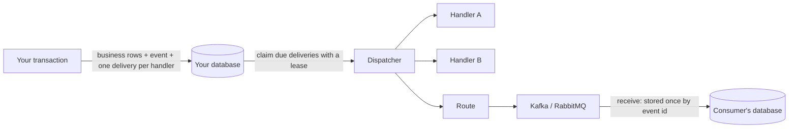

# relaybus

relaybus is a reliable, storage-agnostic event bus for NestJS and Node.js that writes
every event in the same database transaction as your business data (the
transactional outbox pattern) and delivers it to each handler and broker with
independent retries, leases and dead letters. If your transaction commits, the
event is delivered. If it rolls back, the event never existed.

[Documentation](https://berkcansavur.github.io/relaybus/) ·
[Getting started](https://berkcansavur.github.io/relaybus/getting-started) ·
[FAQ](https://berkcansavur.github.io/relaybus/faq) ·
[llms.txt](llms.txt)

[](https://github.com/berkcansavur/relaybus/actions/workflows/ci.yml)
[](https://codecov.io/gh/berkcansavur/relaybus)
[](https://scorecard.dev/viewer/?uri=github.com/berkcansavur/relaybus)
[](LICENSE)

```ts
@Module({
  imports: [RelayBusModule.forRoot({ store: new PostgresEventStore({ pool }) })],
})
export class AppModule {}

export class OrderPlaced extends defineEvent<{ orderId: string }>('order.placed.v1') {}

@Injectable()
export class Shipping {
  @RelayBusConsumer(OrderPlaced)
  async ship(event: EventEnvelope<{ orderId: string }>) {
    /* runs after the order transaction commits, retried until it succeeds */
  }
}

// inside your service
await bus.transaction(async (tx) => {
  await tx.query('INSERT INTO orders ...');
  await bus.publish(new OrderPlaced({ orderId }), { key: orderId });
});
```

## Why

Publishing an event after a database write is a dual write: a crash, a broker
outage or a rollback between the two loses the event or announces a change that
never happened. In-process emitters lose events on restart. Queue libraries on
Redis cannot join your SQL transaction. relaybus implements the transactional
outbox, the idempotent consumer and the competing consumers patterns behind one
small API, for the database you already run.

## When to use relaybus, and when not to

<!-- relaybus:snippet:when-to-use -->

**When to use relaybus**

- A NestJS or Node.js service writes to PostgreSQL or MongoDB and must announce those changes without ever losing an event or announcing a change that rolled back.
- You want several handlers to react to one event, each with its own retries, timeout and dead letters, without one failing handler re-running the others.
- You need to forward events to Kafka or RabbitMQ without a dual write between the database and the broker.
- You want per-key ordering (for example per order or per account) and operational tools: dead letters you can list and requeue, statistics and a health check.

**When not to use relaybus**

- You only need in-process notifications and losing an event on restart is acceptable: [`@nestjs/event-emitter`](https://docs.nestjs.com/techniques/events) is simpler.
- Your stack has no PostgreSQL or MongoDB database to hold the outbox (for example Redis only, or MySQL): look at BullMQ, or [`@nestjs/outbox`](https://github.com/nestjs/outbox) for MySQL, or implement the `EventStore` interface yourself.
- You need global ordering, or exactly-once side effects outside your own database (an HTTP call can repeat; send an idempotency key). relaybus does not claim either.
- You need cron-style recurring jobs or a general work queue: a job queue such as BullMQ or pg-boss fits that model better.

<!-- relaybus:end -->

## relaybus vs alternatives

<!-- relaybus:snippet:comparison -->

|                                                                      | What it is                                                                                                                                                | Survives a restart                | Written in your database transaction                                      | Choose it when                                                                                                       |
| -------------------------------------------------------------------- | --------------------------------------------------------------------------------------------------------------------------------------------------------- | --------------------------------- | ------------------------------------------------------------------------- | -------------------------------------------------------------------------------------------------------------------- |
| **relaybus**                                                         | Event bus built on the transactional outbox: PostgreSQL and MongoDB stores, Kafka and RabbitMQ transports, per-handler deliveries                         | Yes, events live in your database | Yes                                                                       | Events must never be lost or phantom, and handlers need retries, dead letters and ordering keys                      |
| [`@nestjs/event-emitter`](https://docs.nestjs.com/techniques/events) | In-process event emitter built on `eventemitter2`                                                                                                         | No persistence is documented      | No                                                                        | Simple in-process notifications where losing an event on restart is acceptable                                       |
| [`@nestjs/cqrs`](https://docs.nestjs.com/recipes/cqrs)               | CommandBus, QueryBus, EventBus and sagas; the docs say sagas and event handlers run in memory                                                             | No built-in persistence           | No                                                                        | You want CQRS structure; it can sit on top of an outbox                                                              |
| [`@nestjs/outbox`](https://github.com/nestjs/outbox)                 | Transactional outbox module from the NestJS organisation: PostgreSQL, MySQL and in-memory stores, relay with leases and retries, dead-letter table, inbox | Yes with the database stores      | Yes                                                                       | You need MySQL, or a NestJS-organisation module; compare features with relaybus before choosing                      |
| [BullMQ](https://docs.bullmq.io/)                                    | Job queue on Redis with retries, delayed jobs and flows; at-least-once in the worst case                                                                  | Yes, in Redis                     | No, jobs are stored in Redis and cannot join a SQL or MongoDB transaction | Your stack is Redis-based and background jobs matter more than event atomicity                                       |
| [pg-boss](https://github.com/timgit/pg-boss)                         | Job queue on PostgreSQL using `SKIP LOCKED`, with retries, dead letter queues, scheduling and pub/sub; jobs can be created in your own transaction        | Yes, in PostgreSQL                | Yes, through its database adapters                                        | You want a PostgreSQL job queue with scheduling; relaybus is an event bus with per-handler deliveries and transports |
| Kafka client directly                                                | A distributed log; the idempotent producer and transactions give exactly-once within Kafka                                                                | Yes, in Kafka                     | No, producing to Kafka is a second write                                  | You consume and produce only inside Kafka; add an outbox when a database write must be announced                     |

This table summarises the vendors' own documentation as of October 2026; check their docs for current details.
Full comparison and sources: <https://berkcansavur.github.io/relaybus/comparison>.

<!-- relaybus:end -->

## Guarantees

| Property             | Behaviour                                                                                                                                                                                                                                          |
| -------------------- | -------------------------------------------------------------------------------------------------------------------------------------------------------------------------------------------------------------------------------------------------- |
| Atomic publish       | Events are written in the caller's transaction. Rolled back with it, committed with it.                                                                                                                                                            |
| No lost events       | Committed events are delivered to every subscribed handler and route, retried until they succeed or are dead-lettered. Nothing is dropped silently.                                                                                                |
| Delivery             | At-least-once to every handler. A handler subscribed with `transactional: true` that writes through its transaction takes effect exactly once.                                                                                                     |
| Independent handlers | Each handler has its own delivery record: one failing handler never re-runs the others.                                                                                                                                                            |
| Ordering             | Optional per key: events with the same `key` are handled one at a time per handler, in commit order. No global ordering.                                                                                                                           |
| Concurrency          | Workers lease lanes (hash buckets of the ordering key), not rows: one lane row is written per claimed batch and no delivery row. Every state change is fenced by the lane's epoch, so a stalled worker cannot overwrite the worker that took over. |
| Retries              | Capped exponential backoff with full jitter, per handler. Non-retryable errors and exhausted deliveries go to dead letters you can inspect and requeue.                                                                                            |
| Shutdown             | Running handlers finish or are released without losing an attempt.                                                                                                                                                                                 |

What relaybus does **not** claim: exactly-once side effects outside your
database (an HTTP call can repeat; send an idempotency key), or global ordering.

## Packages

| Package                                             | Purpose                                                                                    |
| --------------------------------------------------- | ------------------------------------------------------------------------------------------ |
| [`@relaybus/core`](packages/core)                   | The bus, dispatcher, retry policies and the in-memory store.                               |
| [`@relaybus/nestjs`](packages/nestjs)               | `RelayBusModule`, the `@RelayBusConsumer` decorator, lifecycle and health.                 |
| [`@relaybus/postgres`](packages/postgres)           | PostgreSQL 13+ store for `pg`, Kysely, Knex, TypeORM, Drizzle and Prisma transactions.     |
| [`@relaybus/mongodb`](packages/mongodb)             | MongoDB 6+ store on multi-document transactions; works with Mongoose sessions.             |
| [`@relaybus/kafka`](packages/kafka)                 | Kafka transport for kafkajs and `@confluentinc/kafka-javascript`, CloudEvents binary mode. |
| [`@relaybus/rabbitmq`](packages/rabbitmq)           | RabbitMQ transport with publisher confirms, reconnects, quorum queues and dead letters.    |
| [`@relaybus/testing`](packages/testing)             | The store contract suite, a fake clock and an in-memory transport.                         |
| [`@relaybus/eslint-plugin`](packages/eslint-plugin) | ESLint rules: no calls to other services inside a transaction, no publish outside one.     |
| [`@relaybus/otel`](packages/otel)                   | OpenTelemetry metrics, backlog gauges and one trace across services.                       |

Bring your own store: implement the `EventStore` interface and run the contract
suite from `@relaybus/testing` against it.

## Install

```sh
pnpm add @relaybus/core @relaybus/nestjs @relaybus/postgres pg
```

Node.js 22 or newer. NestJS 11 or 12.

## How it works



1. `publish` writes the event and one delivery per subscribed handler or route
   into the active transaction. Events with a key get a per-key sequence that
   follows commit order.
2. The dispatcher in every process leases lanes, claims their due deliveries in
   batches, runs the handlers, renews the lease while they run and completes
   finished deliveries in batches (completing deletes the delivery row).
3. A failure reschedules the delivery with backoff, or dead-letters it after the
   last attempt. A worker that crashes leaves an expired lease, and another
   worker takes the delivery over.
4. Routes forward events to brokers after commit, so a broker outage only delays
   them. Subscriptions store received events by id before acknowledging them,
   which makes consumption idempotent.

## Core concepts

### Events

```ts
export class OrderPlaced extends defineEvent<{ orderId: string }>('order.placed.v1') {}
// or validated with any Standard Schema library (zod, valibot, arktype):
export class OrderShipped extends defineEvent('order.shipped.v1', { schema: orderShippedSchema }) {}
```

Envelopes follow CloudEvents naming: `id` (UUIDv7), `type`, `source`, `key`,
`payload`, `headers`, `correlationId`, `causationId` and `occurredAt`. Events
published while handling another event inherit its correlation id and record it
as their cause.

### Publishing

```ts
await bus.publish(new OrderPlaced({ orderId }), {
  key: orderId, // ordering + partition key
  delay: '15m', // deliver later
  id: `order-${orderId}`, // deterministic id = idempotent publish
});
```

`publish` finds the transaction in this order: the `transaction` option, the
transaction opened by `bus.transaction()`, then your `transactionResolver`
(for example `@nestjs-cls/transactional`). With none, it throws
`TransactionRequiredError` unless you opt into `transactionMode: 'optional'`.

### Handlers

```ts
@RelayBusConsumer(OrderPlaced, {
  retry: { attempts: 5, initialDelay: '2s', maxDelay: '5m' },
  timeout: '30s',
  concurrency: 4,
  transactional: true, // handler writes + completion commit together
})
async reserveStock(event: EventEnvelope<{ orderId: string }>, context: HandlerContext<PoolClient>) {
  await context.transaction!.query('UPDATE stock ...');
}
```

Throw `NonRetryableError` to dead-letter immediately. Use `context.signal` to
stop work when a timeout, lease loss or shutdown aborts the handler.

### Dead letters and operations

```ts
const dead = await bus.listDeliveries({ status: 'dead', handler: 'Shipping.ship' });
await bus.requeue(dead.map((delivery) => delivery.id));
const stats = await bus.statistics(); // pending, processing, dead, oldestDueAt; completed only with a completion history
```

Observers receive every lifecycle event (published, started, succeeded, retry
scheduled, dead, lease lost, released, purged, failures) and timed hooks (publish, claim,
handler, send, receive, backlog) for logs and metrics. `@relaybus/otel` turns them into
OpenTelemetry metrics and adds one trace from `publish` in one service to the handler in
another; see [Observability](https://berkcansavur.github.io/relaybus/concepts/observability).

## Defaults

| Option          | Default                                                                      |
| --------------- | ---------------------------------------------------------------------------- |
| Handler retries | 10 attempts, 1s initial, ×2, capped at 10m, full jitter                      |
| Route retries   | unlimited attempts, 1s initial, ×2, capped at 5m, 30s publish timeout        |
| Dispatcher      | 10 concurrent handlers, 1s poll, 30s lease renewed every 10s                 |
| Shutdown        | waits 30s, then releases running deliveries                                  |
| Retention       | completed deliveries kept 7 days, dead letters kept until requeued or purged |
| Transactions    | required                                                                     |

Every default can be changed; see each package's README for the full option list.

## Quality

- 100% statement, branch, function and line coverage, enforced in CI, with no
  coverage-ignore comments.
- Every store runs the same contract suite against a real database: commit-order
  sequencing, concurrent claimers in separate processes, fencing, starvation and
  data fidelity.
- Transports are tested against real Kafka and RabbitMQ brokers, including broker
  restarts and poison messages.
- Adversarial reviews whose findings were fixed with regression tests.
- Mutation testing, CodeQL, OpenSSF Scorecard and npm provenance in CI.

## Releases

Every push to `main` with releasable [Conventional Commits](https://www.conventionalcommits.org/) publishes all `@relaybus/*` packages to npm with one shared version, computed by semantic-release. While the version is below 1.0.0 a breaking change bumps the minor version. There is no committed changelog: the [GitHub Releases](https://github.com/berkcansavur/relaybus/releases) page is the changelog. Prereleases are published from the `next` and `beta` branches under the matching npm dist-tags. Details: [docs/releasing.md](docs/releasing.md).

## Contributing

See [CONTRIBUTING.md](CONTRIBUTING.md). Security issues: [SECURITY.md](SECURITY.md).

## License

[MIT](LICENSE) © Berkcan Şavur
